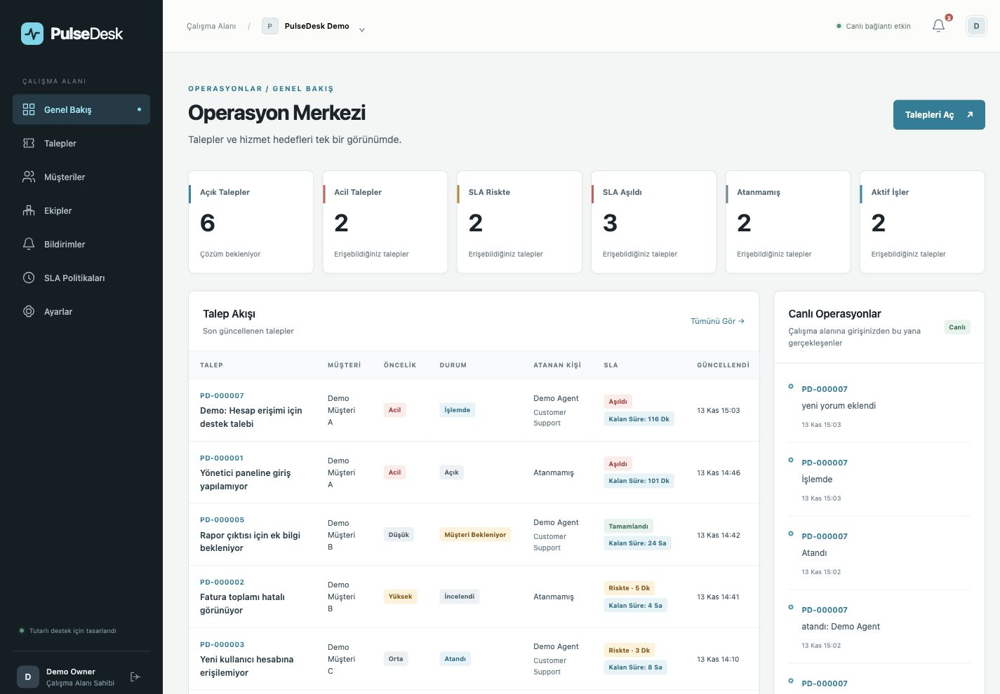
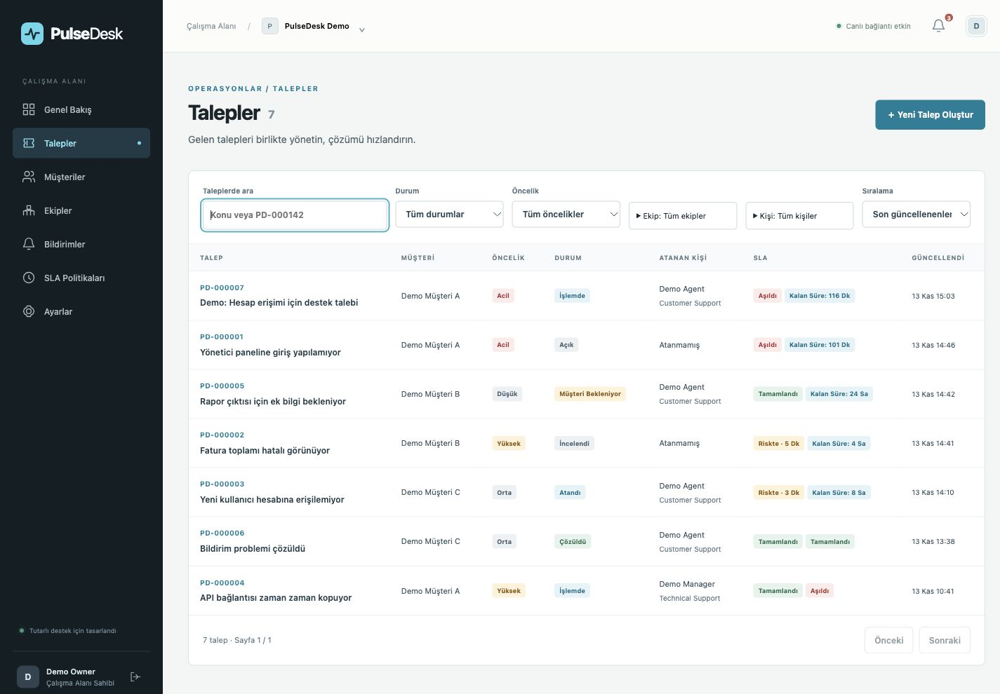
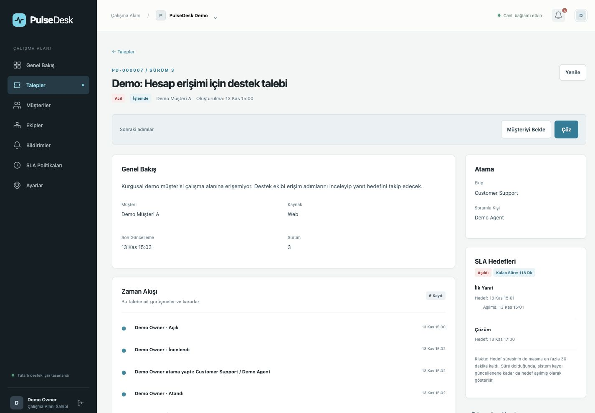
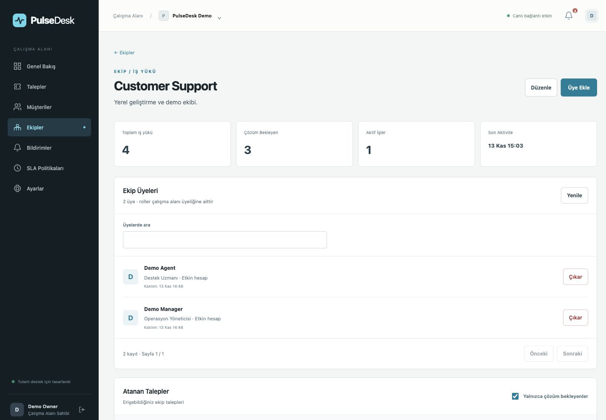
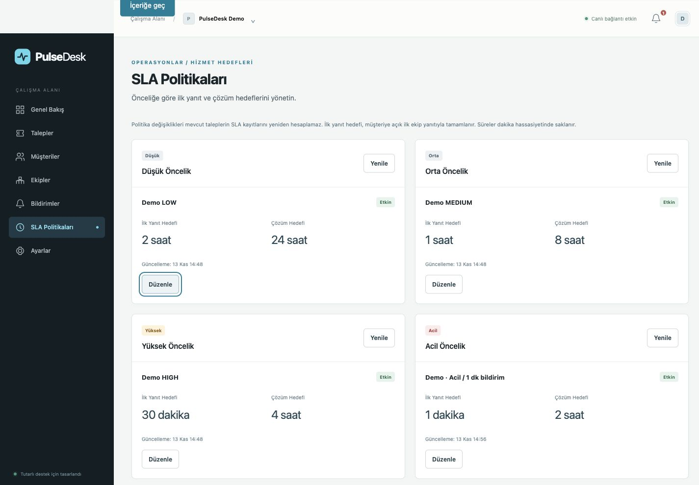
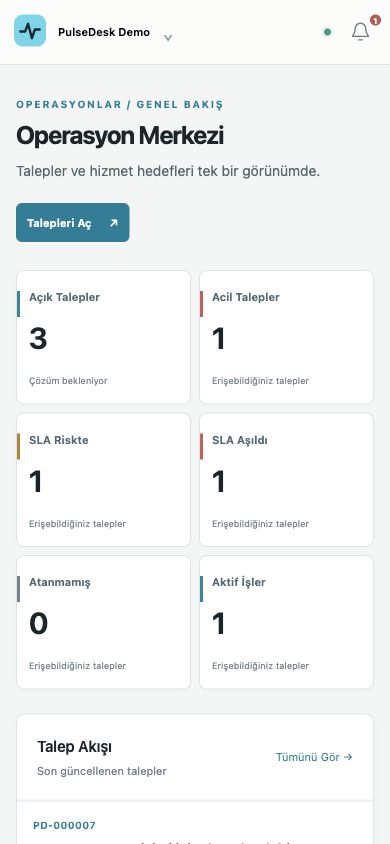

# PulseDesk

**A multi-tenant support workspace for tickets, team ownership and response deadlines.**

PulseDesk connects customer context, assignments, comments and SLA state so support teams can see who owns a request, what changed and what needs attention.

[Technical case study](docs/case-study.md) · [Architecture](docs/architecture.md) · [Demo script](docs/demo-script.md) · [Verification](docs/verification.md)

**Stack:** TypeScript · NestJS · Next.js/React · PostgreSQL/Prisma · Redis/BullMQ · Socket.IO

## Product scope

- Search and filter tickets; triage, assign, work, resolve and close them through explicit commands.
- Manage customers, teams and SLA policies in an organization workspace.
- Inspect comments, assignment/status history and recipient-scoped notifications.
- Reconcile realtime changes across authorized sessions while keeping HTTP/database state authoritative.

The project demonstrates tenant-aware data relations, membership-based RBAC, optimistic concurrency and transactional outbox delivery. The [case study](docs/case-study.md) explains the implementation, evidence and trade-offs.

## Screenshots

Real captures from the running local application on **13 November 2026**, using fictional demo identities. Desktop images share a 1425 × 990 export size; mobile is 390 × 844. Counts reflect the local records and their actual SLA state.



| Ticket queue                                                                                                          | Ticket detail and history                                                                                                            |
| --------------------------------------------------------------------------------------------------------------------- | ------------------------------------------------------------------------------------------------------------------------------------ |
|      |  |
| Team management                                                                                                       | SLA policies                                                                                                                         |
|  |                |

<details>
<summary>Mobile dashboard</summary>



</details>

## Demo

**Hosted demo: deployment pending.** There is no public demo URL or published video yet.

A local seed provides five roles, two teams, three fictional customers and ticket/SLA/history scenarios. See the [demo setup](docs/demo-environment.md), [local portfolio runbook](docs/portfolio-demo.md) and [60–90 second recording script](docs/demo-script.md). Demo identities and credentials are local-only.

Full user invitations/role editing, email delivery, attachments and a separate reporting product are outside the implemented demo scope. Public comments are stored application replies, not sent emails.

## Engineering decisions

| Concern           | Implemented approach                                                                     |
| ----------------- | ---------------------------------------------------------------------------------------- |
| Tenant boundaries | Current membership checks, organization-scoped queries and composite foreign keys        |
| Authorization     | OWNER / ADMIN / MANAGER / AGENT / VIEWER; guarded commands and live recipient checks     |
| Concurrent edits  | Ticket version/status preconditions; conflicts return 409                                |
| Asynchronous work | PostgreSQL outbox records, Redis/BullMQ SLA jobs and a separate worker                   |
| Realtime          | API-owned outbox dispatch; authenticated Socket.IO hints followed by HTTP reconciliation |

The current realtime layer assumes a single API instance. It is not a distributed exactly-once delivery system. Details and source links are in the [case study](docs/case-study.md).

## Run locally

The repository targets **Node 24** and **pnpm 10.28.2**, with Docker Compose for PostgreSQL and Redis. The current local review used **Node 25.1.0**; this is not Node 24 validation.

1. Install dependencies with `pnpm install --frozen-lockfile`.
2. Configure ignored local environment files using the [setup guide](docs/demo-environment.md). Never commit credentials or use production databases for demo/test commands.
3. Start local services with `docker compose up -d --wait`, apply existing local migrations with `pnpm db`, and optionally run `pnpm seed`.
4. Start with `pnpm dev`. If this Mac's watcher/FSEvent limit prevents watch mode, use the existing [build/start alternative](docs/portfolio-demo.md#yerel-ortam).

Web: <http://localhost:3000/login> · API liveness: <http://localhost:4000/health> · API readiness: <http://localhost:4000/ready>. Readiness checks PostgreSQL and Redis, not the separate worker. These are local addresses, not hosted demo links.

## Quality evidence

```sh
pnpm lint
pnpm typecheck
pnpm test
pnpm build
```

On **13 November 2026**, Node's test runner reported **66 passed / 8 skipped** without integration services and **213 passed / 0 skipped** with dedicated migrated PostgreSQL and namespaced Redis (43 web + 170 API, including nested subtests). The execution scopes differ; no generic “200+” badge is used.

See [verification](docs/verification.md) for commands, runtime versions, current lint/typecheck/build results, browser/accessibility checks and limits. CI configuration is in [.github/workflows/ci.yml](.github/workflows/ci.yml); the local review does not claim an unpublished commit has passed remote CI or been deployed.

## Technical references

[Domain model](docs/domain-model.md) · [Authentication](docs/authentication.md) · [Ticket lifecycle](docs/ticket-lifecycle.md) · [SLA worker](docs/sla-engine.md) · [Realtime contracts](docs/realtime.md) · [Frontend architecture](docs/frontend-architecture.md) · [Management UI](docs/management-ui.md)
