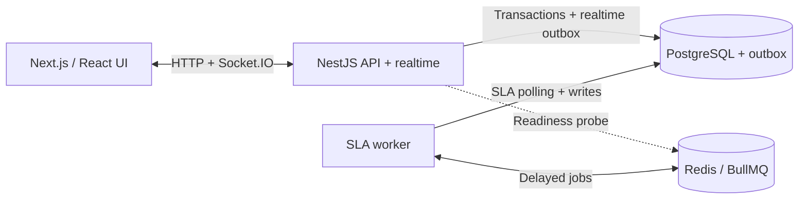

# PulseDesk architecture

The diagram shows the current local application boundaries. It does not introduce a gateway, a notification microservice or a distributed Socket.IO adapter.

1. The API commits a domain change with history/audit and outbox records in PostgreSQL.
2. The **API** dispatches ticket/notification outbox hints to authorized Socket.IO recipients.
3. The **worker** dispatches SLA outbox records into BullMQ and processes persisted deadlines.
4. A worker breach writes notifications/outbox rows back to PostgreSQL; API polling delivers the resulting realtime notification.
5. The browser reconciles hints through HTTP. PostgreSQL remains authoritative.

The current realtime layer requires one API instance. Redis in this diagram is not a browser replay store or cross-instance Socket.IO adapter. The web app, API, worker, PostgreSQL and Redis are the five processes/services needed for a local demonstration.

Sources: [AppModule](../apps/api/src/app.module.ts), [realtime runtime](../apps/api/src/modules/realtime/realtime-dispatch-runtime.ts), [SLA worker](../apps/api/src/worker/worker-runtime.service.ts), [Compose](../docker-compose.yml).
