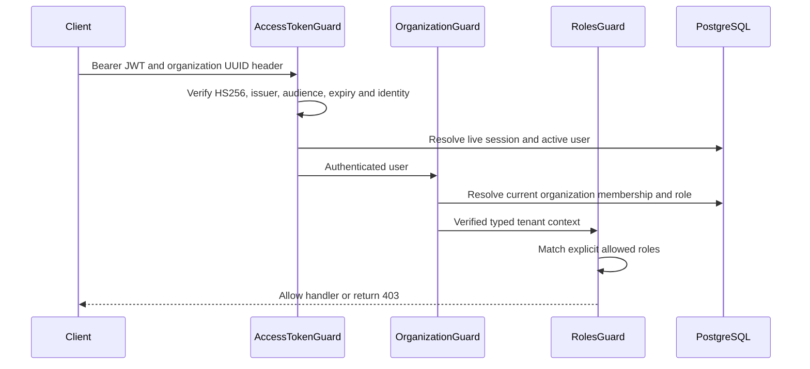

# Authentication and organization authorization — Phase 2

The backend now provides password authentication, revocable sessions, live organization context, and explicit role checks. Phase 3 now provides [team/customer/ticket APIs](ticket-lifecycle.md) using these guards. Frontend authentication screens, incident operations, email delivery, WebSockets, and background workers remain unimplemented. Phase 3 changes ticket numbering/versioning only; the authentication/session schema remains unchanged. Swagger was not previously installed and is not added.

## API contract

All request bodies are JSON objects. DTOs reject unknown fields, invalid types, malformed emails, and oversized field values. Validation errors do not echo submitted values. Emails are trimmed and lowercased, without provider-specific rewriting. Names and organization names are trimmed and limited to 1–100 characters. Passwords are 10–128 characters, untrimmed, with no mandatory character classes. Refresh tokens must have the generated 64-character base64url format.

| Endpoint               | Request / authorization                         | Successful response                                     |
| ---------------------- | ----------------------------------------------- | ------------------------------------------------------- |
| `POST /auth/register`  | `name`, `email`, `password`, `organizationName` | `201`, session and public profile                       |
| `POST /auth/login`     | `email`, `password`                             | `200`, session and public profile                       |
| `POST /auth/refresh`   | `refreshToken`                                  | `200`, replacement session and public profile           |
| `POST /auth/logout`    | `refreshToken`                                  | `204`, empty body; repeated/unknown tokens are harmless |
| `GET /auth/me`         | `Authorization: Bearer <accessToken>`           | `200`, public user and memberships                      |
| `GET /auth/context`    | Bearer token and `X-Organization-Id` UUID       | `200`, database-verified tenant context                 |
| `GET /auth/owner-only` | Same headers, current `OWNER` membership        | `200`, verified tenant context                          |

The last two endpoints are Phase 2 verification endpoints, with no domain data or side effects. They can be removed with their two controller methods after feature routes exercise the same guards.

Session responses include `accessToken`, `refreshToken`, `accessTokenExpiresIn` (seconds), `refreshTokenExpiresAt`, `user`, and `memberships`. Tokens are intentionally returned only by register/login/refresh; clients must protect those responses. There are no auth cookies yet. Public users contain only `id`, `name`, `email`, `avatarUrl`, and `isActive`. Memberships contain `organizationId`, `organizationName`, `organizationSlug`, `membershipId`, and `role`. No organization is automatically selected, including when multiple memberships exist. `/me` returns no tokens.

All auth success responses and filtered errors set `Cache-Control: no-store`. Errors use `{ "statusCode": number, "message": string }`. Malformed requests return `400`, authentication failures `401`, missing membership/role permission `403`, registration conflicts `409`, and rate limits `429`. Missing or invalid organization UUID headers on otherwise authenticated organization requests return `400`. Unknown and inaccessible organizations both return `403`. Unexpected errors return a generic `500` without database details or stack traces. Logging of unexpected request failures contains only a fixed message; request bodies, authorization headers, credentials, hashes, and raw exception objects are not logged.

## Registration and login

Registration hashes the password before opening a transaction. The transaction creates the user, organization, OWNER membership, and hashed refresh session, signs the access JWT, and reads the safe response. A failure, including signing failure, rolls all database writes back. Organization slugs use a readable normalized prefix plus a random suffix. The database unique constraint remains authoritative; organization creation conflicts retry the complete transaction up to five times. Duplicate normalized emails return `409`, including concurrent attempts. Slug retries are identified at the organization write rather than relying on adapter-specific error metadata.

Login reads only the fields needed for password verification. Unknown email, wrong password, and inactive accounts all return the same generic `401`. Unknown-email verification uses a precomputed dummy Argon2id hash to avoid an obvious skipped-hashing timing path; this is not a claim of perfectly equal request timing. The transaction locks the user row and rechecks activity before issuing the session. It never accepts role, organization, user ID, active status, or hash fields from the client.

Password hashes use Argon2id with 19,456 KiB memory, two iterations, one lane, and a fresh library-generated salt. These parameters follow the [OWASP Argon2id guidance](https://cheatsheetseries.owasp.org/cheatsheets/Password_Storage_Cheat_Sheet.html#argon2id); production deployments should benchmark them under expected load. Password hashes are selected only for verification and are never spread into profile responses.

## Access and refresh tokens

Access tokens are JWTs signed with explicitly configured `HS256`, issuer `pulsedesk-api`, audience `pulsedesk-web`, and a default 900-second lifetime. Claims are user `sub`, refresh-record `sid`, and standard issuance/expiry/issuer/audience fields. Role and organization claims are neither issued nor trusted. Verification requires the configured algorithm, issuer, audience, expiry, issuance time, and valid UUID identities. Each authenticated request also reads the referenced refresh row and its active user. A revoked, expired, deleted, or mismatched session is rejected even if the JWT has time remaining. This intentionally trades stateless JWT verification for immediate database-backed revocation.

Refresh tokens are opaque values made from 48 cryptographically random bytes (384 bits), encoded as 64 base64url characters. Only their SHA-256 hash is stored in the existing `RefreshToken.tokenHash` column. A fast one-way hash is appropriate here because the input has high random entropy; passwords use the slower Argon2id algorithm instead. Refresh tokens are not JWTs and require no refresh signing secret. Default refresh lifetime is 30 days.

Each issued refresh token has its own database row, expiry, and revocation timestamp. Login sessions are capped at ten active, unexpired rows per user. Issuance locks the user row and revokes the oldest excess sessions rather than silently accumulating unlimited active tokens. Revoked and expired rows are retained; automated retention/cleanup is deferred.

## Rotation, concurrency, and logout

Refresh looks up the token hash, locks its user row, and checks user activity. A conditional update consumes the unrevoked, unexpired token exactly once. Revoking that row, creating its replacement, signing the new access JWT, and building the response all occur inside the same transaction. If any step fails, the old token remains usable. Two simultaneous refresh requests have one winner and one `401`; clients must serialize refreshes and atomically replace both tokens.

Rotation changes the `sid` and invalidates access JWTs tied to the old row immediately after commit. Presenting the old refresh token again returns `401` and cannot mint another token. There is no retry grace window and no parent/family field: replay rejection does **not** automatically revoke the winning successor or other login sessions. This avoids treating a concurrent stale request as authority to revoke another session, but does not provide token-family compromise detection. Family-wide revocation and reliable lost-response recovery are explicit future improvements.

Logout revokes the row matching the presented refresh token's hash, without deleting it. It is idempotent and does not reveal token existence. Both refresh and access tokens tied to that row then fail. Clients must present their latest refresh token: logging out an already-rotated predecessor does not revoke its successor. There is no logout-all endpoint in this phase. User deactivation blocks every existing session while inactive; it does not permanently revoke them, so administrative deactivation tooling must explicitly revoke sessions when permanent invalidation is intended.

```mermaid
sequenceDiagram
    participant Client
    participant Auth as Auth service
    participant DB as PostgreSQL
    Client->>Auth: POST /auth/refresh (opaque token)
    Auth->>DB: Begin transaction; find hash; lock user
    Auth->>DB: Recheck active user; consume unrevoked, unexpired row
    alt Invalid, expired, revoked, or replayed token
        Auth->>DB: Roll back
        Auth-->>Client: 401 generic authentication failure
    else Valid token
        Auth->>DB: Create replacement token hash
        Auth->>Auth: Sign short-lived JWT with replacement sid
        Auth->>DB: Commit
        Auth-->>Client: New access/refresh tokens and safe profile
    end
```

## Tenant context and RBAC

Authentication and authorization are separate guards. `AccessTokenGuard` resolves a current active user and live session. `OrganizationGuard` then validates the header UUID and queries the current `OrganizationMember`, organization, and user activity. Membership presence is the Phase 1 validity criterion: there is no separate active-membership column. Organization context is never taken directly from a header or JWT. Removing membership or changing role takes effect on the next organization request without waiting for JWT expiry.

The typed context is `{ userId, organizationId, membershipId, role }`. `@CurrentUser()` and `@CurrentTenant()` expose verified data without ad hoc untyped request mutation. `RolesGuard` checks an explicit allowed-role list from `@Roles(...)`; there is no numeric hierarchy. `OWNER`, `ADMIN`, `MANAGER`, `AGENT`, and `VIEWER` are distinct values. OWNER-only means exactly OWNER, not OWNER-or-ADMIN.

Future organization routes should import `AuthModule` and use the composition helper:

```ts
@OrganizationAccess('OWNER', 'ADMIN')
@Get('example')
example(@CurrentTenant() tenant: TenantContext) {
  // Scope every domain query using tenant.organizationId.
}
```

The helper runs authentication, organization membership, then role authorization in that order. `@OrganizationAccess()` permits any verified current member. Use `@Roles` directly only with all three guards in the same order. The exported guards resolve their dependencies through the auth module. A plain new Nest route is not automatically protected; reviewers must require the appropriate guard declaration. There is no generic tenant repository or row-level security. Composite database constraints remain a second boundary for writes, while scoped filters remain mandatory for reads and mutations. Phase 3 domain mutations additionally revalidate and lock actor membership/user state inside their transaction. Future sensitive writes must retain that pattern; per-request checks alone cannot make a later write immune to a concurrent membership change.



## Configuration and local startup

`JWT_ACCESS_SECRET` is required in every environment; there is no committed or automatic development secret. Startup rejects secrets shorter than 32 bytes, low-diversity strings, and common placeholder patterns. Generate a random value with `openssl rand -base64 48` and put it in your ignored root `.env`. These checks cannot prove randomness: production secrets must come from a suitable secret manager. Do not use test keys in production. Rotating this key invalidates existing access JWTs; opaque refresh rows remain valid until revoked/expired.

`JWT_ACCESS_TTL` is an integer in seconds, defaults to `900`, and allows `60`–`1200`. `REFRESH_TOKEN_TTL` defaults to `2592000` seconds and allows `3600`–`7776000`. `DATABASE_URL` handling remains unchanged. `JWT_REFRESH_SECRET` is no longer advertised because opaque refresh tokens are not signed. No real environment file is committed.

```sh
cp .env.example .env
# Configure DATABASE_URL and a generated JWT_ACCESS_SECRET in .env.
docker compose up -d --wait postgres
pnpm --filter @pulsedesk/api prisma:migrate:deploy
pnpm dev
```

The API remains on port 4000. Registration and login return bearer credentials in JSON for API clients. TLS is required outside local development. Browser storage, secure cookie transport, CORS policy, and CSRF defenses must be designed together when the frontend auth phase is implemented; no browser authentication UI or cookie behavior is claimed here.

## Rate limiting and deployment assumptions

Nest's supported `@nestjs/throttler` uses an in-memory, per-route, per-IP limiter: register and login allow 10 requests/minute; refresh allows 30/minute; other auth endpoints default to 60/minute. All limits apply before credential processing. `429` responses retain retry headers. Tests exercise the real guard independently; the main database auth suite bypasses it so repeated fixture setup does not mask authentication assertions.

Counters reset on restart and are not shared between replicas. Shared NATs can affect many users, and per-IP limits alone do not stop distributed attacks or provide account-based protection. Redis-backed storage, account-aware abuse controls, and operational monitoring remain deferred. Proxy trust is not enabled: deployment behind a reverse proxy must configure only known trusted hops before relying on client IP limits. Never blindly trust client-supplied forwarding headers.

## Verification and security boundaries

`pnpm test` runs configuration, Argon2id, rate-limiter, lifecycle, and health tests without a database. PostgreSQL auth and tenant-constraint suites run when an explicitly exported `TEST_DATABASE_URL` targets a dedicated migrated test database. Auth tests create randomized fixtures and remove only their tracked users, organizations, memberships, and token rows. The constraint suite rolls back its fixtures. Neither suite resets a database. Test processes generate an ephemeral signing secret and fixed test TTLs through the test-only preload; application startup never imports that preload. CI already supplies its isolated PostgreSQL test URL.

HTTP tests cover atomic registration, duplicate email races, forced slug collisions, signing-failure rollback, login failures, inactive/deleted users, public profiles, rotation/replay/concurrency, failed-rotation rollback, expiry, idempotent logout, JWT rejection, live role changes, removed memberships, foreign tenants, missing/malformed headers, DTO validation, and session limits. Built API smoke checks also exercise registration, login, `/me`, refresh, logout, and organization guards against PostgreSQL.

The security review checks public projections, hashed-only refresh persistence, explicit JWT verification, live database authorization, transactional writes, compare-and-swap rotation, strict DTO allowlists, sanitized errors/logging, and ignored environment files. This is a backend foundation, not a claim of complete authentication security. Deferred work includes password reset, email verification, MFA, OAuth/SSO, email delivery, distributed rate limiting, session management/logout-all, token-family reuse detection, retention, security-event monitoring, signing-key rotation operations, permission capabilities, and frontend transport/UI design.
