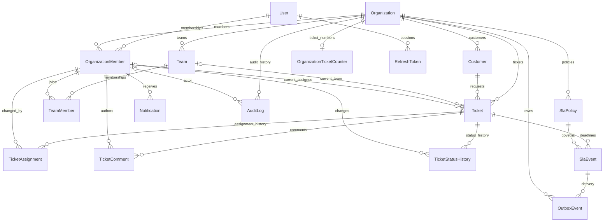

# PulseDesk core domain — Phase 1

This document records the Phase 1 persisted data and database infrastructure. Phase 2 adds [backend authentication and live organization authorization](authentication.md). Phase 3 adds [team/customer/ticket operations](ticket-lifecycle.md), a per-organization number counter, and ticket workflow versioning. Phase 4 adds the [SLA engine](sla-engine.md), a tenant-safe transactional outbox, and notification types/entity references. Frontend screens and realtime delivery remain unimplemented. The existing `/health` endpoint remains a liveness response.

## Identity and tenancy

All primary IDs are UUID v4 values generated by Prisma's `uuid()` default and stored as PostgreSQL `uuid`. They are opaque, application-safe IDs; human ticket numbers are separate. Direct SQL writers must supply UUIDs themselves. IDs are not an authorization boundary. Timestamps use `timestamptz(3)` and represent instants; clients should display them in the user's timezone. Prisma supplies `updatedAt` on writes; direct SQL writers must maintain it.

`User` is a global identity with unique email, password hash, optional avatar, and an active flag. It has no organization role. `Organization` has a unique slug. `OrganizationMember` links a user to an organization, uniquely per organization/user, and carries `OWNER`, `ADMIN`, `MANAGER`, `AGENT`, or `VIEWER`. A user may have different roles in different organizations.

Every organization-owned table includes a required `organizationId`, including ticket children, SLA events, and notifications. `User` and `RefreshToken` are intentionally global. Each tenant child references its organization directly. Relations to other tenant entities use composite foreign keys `(organizationId, relatedId)` referencing unique `(organizationId, id)` pairs. The redundant unique pairs are required by PostgreSQL to support these foreign keys; globally unique IDs alone do not prove tenant consistency.

A `Team` belongs to an organization, with a unique name inside it. `TeamMember` connects a team to an organization membership, not directly to a user. Its composite foreign keys require both ends to belong to the same organization, and duplicate team membership is forbidden.

A `Customer` belongs to an organization and may have email, phone, company, and notes. Customer email is not unique: shared inboxes and absent email are valid. Name, email, and company indexes support tenant-scoped equality and ordered lookups; they do not provide full-text or arbitrary substring search.

## Relationships



The diagram summarizes relationships. The schema and migration contain the complete composite tenant keys, optional assignment targets, and direct organization foreign keys.

## Ticket aggregate and lifecycle

`Ticket` requires an organization and customer, with optional current team and member assignments. Neither target is required, and team-only or member-only assignment is valid. Both targets must share the ticket's organization. A member assigned alongside a team is not automatically proven to be a member of that team; Phase 3 assignment commands enforce that routing rule when both targets are supplied.

`ticketNumber` is a positive integer unique within an organization. Different organizations may both have ticket `1`. Phase 3 allocates numbers through an atomic organization counter upsert inside the ticket creation transaction. The additive counter migration backfills existing maximum numbers. `Ticket.version` provides workflow preconditions; see the lifecycle document for concurrency details.

Statuses are `OPEN`, `TRIAGED`, `ASSIGNED`, `IN_PROGRESS`, `WAITING_CUSTOMER`, `RESOLVED`, `CLOSED`, and `CANCELLED`. Priorities are `LOW`, `MEDIUM`, `HIGH`, and `URGENT`. Sources are `WEB`, `EMAIL`, `PHONE`, `CHAT`, and `INTERNAL`. Defaults are `OPEN`, `MEDIUM`, and `WEB`.

An anticipated path is OPEN → TRIAGED → ASSIGNED → IN_PROGRESS → WAITING_CUSTOMER or RESOLVED → CLOSED. Phase 3 implements the explicit primary transitions, pre-work cancellation, and pre-work reassignment in services, including resolved/closed timestamps. Reopening is deferred. The enum alone does not enforce this graph; domain commands do.

`TicketStatusHistory` stores the previous and next status, actor membership, optional reason, and timestamp. `fromStatus = null` represents initial creation. Services must write the ticket and its initial history together, and subsequent changes and history in the same transaction, with concurrency control to avoid lost updates. Phase 3 commands write initial/transition history atomically with ticket state and audit; the database does not independently produce or reconcile history.

## Assignment and comments

`TicketAssignment` is an append-only-by-convention historical record of the resulting assignment at a particular action, with an actor and timestamp. It is not a unique one-to-one mirror of the ticket. Multiple records per ticket are allowed. Both targets null explicitly represents unassignment. The previous assignment can be reconstructed from earlier events. Services must write assignment history atomically with updates to the ticket's current targets. Phase 3 exposes no assignment-history mutation routes and writes assignment changes atomically. Triggers and append-only database privileges are not implemented.

`TicketComment` requires an organization membership author and body. Visibility is `INTERNAL` (default) or `PUBLIC`. Public means eligible for future customer presentation, not anonymous access. Phase 3 enforces staff access, author identity, and nonempty/size-limited content; comment editing and external customer visibility remain deferred. Attachments are not modeled.

## SLA policy and events

`SlaPolicy` has a priority, positive first-response and resolution durations in minutes, and an active flag. A partial unique SQL index allows at most one active policy per organization and priority, while permitting any number of inactive policies. Zero active policies is valid. Policy switching must deactivate the old policy and activate the new one in one transaction, in that order.

`SlaEvent` records a policy, ticket, type (`FIRST_RESPONSE` or `RESOLUTION`), due time, completion time, and breach time. Composite keys require the policy and ticket to share the event's organization. One event per ticket and type is allowed. This initial design assumes one first response and one resolution deadline per ticket; reopening cycles, pause calendars, and policy versioning require a later explicit design change.

The deadline is materialized in `dueAt`, so changing a policy does not automatically change existing event deadlines. Services must select an active policy matching ticket priority at the time of scheduling. Foreign keys do not validate priority or active state. Completed events may also have `breachedAt` when completion was late. Phase 4 implements UTC timing, atomic completion, row-locked idempotent breach processing, and asynchronous late-completion reconciliation; see the SLA engine guide.

The `(completedAt, breachedAt, dueAt, id)` index supports deadline diagnostics. Phase 4 uses delayed ID-only BullMQ jobs rather than scanning tickets or deadlines. Workers are privileged cross-tenant infrastructure and re-read tenant-consistent event/ticket state; normal request queries remain tenant scoped. Ticket/type uniqueness supports per-ticket SLA lookup, and a tenant/policy index supports policy history queries.

## Notifications, auditing, and sessions

`Notification` belongs to an organization membership recipient, with a required matching organization, type, title, message, optional read time, and creation time. Initial types are `SYSTEM`, `TICKET_ASSIGNED`, `TICKET_UPDATED`, and `SLA_BREACHED`. Phase 4 adds typed SLA breach notifications and recipient-scoped inbox/read APIs; external delivery and realtime remain deferred. The recipient/read/time index supports scoped inbox and unread queries.

`AuditLog` stores organization, optional actor membership, action, entity type/ID, optional JSON metadata, and creation time. A null actor represents a system operation. A supplied actor must share the organization. Indexes support organization timelines, entity history, and actor history with stable timestamp/ID ordering. The entity reference is polymorphic and deliberately has no foreign key; future services must validate entity ownership before recording it. Do not store passwords, token hashes, secrets, raw authorization headers, or unnecessary personal data in metadata. Services must sanitize and size-limit it. Restrictive foreign keys preserve references, but do not make logs immutable: append-only permissions, retention, and export policies remain future work.

`RefreshToken` belongs to a user rather than a membership, stores only a unique hash, and has expiry and optional revocation times. Expiry must be after creation. Phase 2 implements hashing, high-entropy issuance, rotation, revocation, expiry enforcement, and rejection of consumed-token replay. Token-family compromise detection remains deferred. A token is not evidence of membership in any particular organization; Phase 2 authorization resolves current membership for each organization request. User/revocation and expiry indexes support session management and cleanup.

## Database guarantees

- Unique user email and organization slug (case-sensitive PostgreSQL text equality).
- One membership per organization/user, one team name per organization, and one team membership per team/member.
- One positive ticket number per organization, separate from its primary UUID.
- Required organization references on all tenant tables.
- Composite foreign keys prevent cross-organization customer, team, member, ticket, policy, recipient, and actor relationships, including optional relations when supplied. This applies to writes and updates, not just creation.
- One SLA event per organization/ticket/type; positive SLA durations; at most one active policy per organization/priority.
- Unique token hash and expiry after creation.
- Enums, non-null fields, and intentional restrictive foreign keys.

`Ticket_positive_number`, `SlaPolicy_positive_durations`, `RefreshToken_valid_expiration`, and `SlaPolicy_one_active_priority` are custom SQL in the initial migration. Prisma validation alone does not validate their presence in a database. Preserve them when creating future migrations, review migration diffs for drops or drift, and use migration deployment rather than `db push` as the database authority.

## Delete and update decisions

All tenant foreign keys and user-to-membership references use `onDelete: Restrict` and `onUpdate: Restrict`. Deleting an organization with operational data, a customer with tickets, a ticket with history, a policy with events, or a membership referenced by history fails rather than silently destroying data. An audit actor is nullable for system events, but deletion does not automatically null it. History rows also have direct restrictive organization references.

Refresh tokens are the sole cascade exception: hard deletion of a user removes credential artifacts, not operational history. Existing memberships still block user deletion. Users can be deactivated with `isActive`; this phase does not add blanket soft deletion. Unreferenced resources may still be hard-deleted. A future offboarding, retention, or anonymization workflow must explicitly address references and legal retention needs. Raw delete access can still remove child records first; foreign keys are not an immutable archive.

Tenant identifiers must be treated as immutable by services. Restricting referenced key updates prevents cascading reassignment of related data, but does not prohibit every possible update of an unreferenced row's organization.

## Required service rules and future tests

Database constraints prevent invalid links, not unauthorized reads or writes. No PostgreSQL row-level security is configured. Every request must derive its organization from authenticated, authorized context and include it in filters; an ID-only Prisma query can still access another organization's record. The exported Prisma service is deliberately a low-level infrastructure primitive, not a tenant authorization wrapper.

Phase 3 implements the scoped operational endpoints described in the lifecycle document. Their guarantees and remaining future rules include:

- Phase 2 implements active-user checks and explicit role allowlists. Last-owner protection, invitations, and membership management rules remain future work.
- Phase 2 canonicalizes registered/login emails and generates collision-safe slugs, with auth DTO length/nonempty validation. Existing text unique constraints remain case-sensitive; non-auth imports and future write paths must use the same canonicalization or add a database constraint.
- Phase 3 checks team routing eligibility when both assignment targets are supplied; team-only access follows current membership.
- Phase 3 implements concurrent organization-local numbering, transition legality, lifecycle timestamps, atomic history, and version preconditions. History has no mutation endpoints; database-level append-only privileges remain deferred.
- Phase 3 implements customer and staff-comment access rules. External customer comment visibility remains deferred; Phase 4 implements recipient-only notification read/update APIs.
- Phase 4 implements SLA policy selection, UTC deadlines, transactional completion/breach handling, and worker retries. Priority editing, reopening, calendars, and pause semantics remain deferred.
- Audit metadata sanitization, entity tenancy, append-only access, and retention; future session-management and token-family compromise detection (basic auth and expiry/revocation checks now exist).
- Scoped reads, bulk writes, connect/update/upsert operations, and background jobs against adversarial organization IDs. Composite foreign keys do not replace these tests.

`test/tenant-constraints.test.ts` exercises real PostgreSQL rejection of cross-tenant links, uniqueness, custom checks, and restrictive deletes. It is explicitly skipped without `TEST_DATABASE_URL`. Fixtures use a single rollback-only transaction with savepoints; it never resets the database. Use a dedicated migrated test database, never a production database. Unit tests cover Prisma lifecycle invocation/failure propagation and the existing HTTP health contract with the database provider overridden.

## Infrastructure and migrations

`DatabaseModule` provides and exports `PrismaService`; it is imported once by the application and is not a global singleton. Future domain modules should import the same module. The service uses Prisma 7's PostgreSQL driver adapter, connects on Nest module initialization, and disconnects during application shutdown, after worker draining. Existing shutdown hooks support graceful process termination. The API now requires a configured, reachable database at startup; builds and unit tests do not. No repository classes or query/domain services are introduced.

The existing Prisma 7 setup generates CommonJS-compatible client code under ignored `src/generated/prisma`. Client generation runs before API dev, build, type checking, and tests, and is part of API build cache outputs. The CLI, client, and adapter are pinned together to `7.10.1`. Database URLs remain in environment variables; the CLI config continues loading local/root ignored environment files.

The initial migration is `20261025000000_init_core_domain`. It was generated from the validated schema using `prisma migrate diff --from-empty --to-schema ... --script` and extended with the documented SQL constraints. Generating SQL does not apply it to a database. No seed, reset, or destructive database operation is included.

```sh
# Configure DATABASE_URL in the existing ignored root .env, then:
docker compose up -d --wait postgres
pnpm --filter @pulsedesk/api prisma:validate
pnpm --filter @pulsedesk/api prisma:generate
pnpm --filter @pulsedesk/api prisma:migrate:deploy
pnpm --filter @pulsedesk/api prisma:migrate:status
```

For future schema edits use `prisma:migrate:dev --name descriptive_name` against a development database, review the SQL, and commit schema and migrations together. Do not reset an existing database to force migration success. Existing nonempty databases need an explicit schema review/baselining plan before applying this first migration.

CI provisions an isolated PostgreSQL service, deploys migrations, checks their status, and runs the actual constraint suite. Local PostgreSQL migration application and status verification require an available database and must be reported separately from schema validation and SQL generation.

## Phase 3 additions

`OrganizationTicketCounter` is a one-to-one infrastructure row keyed by organization UUID, with a nonnegative last allocated number and restrictive organization foreign key. It intentionally reuses the parent UUID rather than generating a second identity. `Ticket.version` is a nonnegative integer starting at zero. Migration `20261025010000_ticket_operations` adds and initializes these fields without editing the original migration. Domain services now enforce ticket/assignment/comment permissions and atomic history/audit writes described in [ticket-lifecycle.md](ticket-lifecycle.md); the remaining SLA, offboarding, retention, and future authorization considerations above still apply.

## Phase 4 additions

Migration `20261025020000_sla_engine` adds `OutboxEvent` with required organization/event UUIDs, explicit scheduled/completed event types, creation/processing/next-attempt timestamps, attempts, and a bounded sanitized last-error code. Its composite foreign key references the new `(organizationId, id)` unique key on `SlaEvent`; `(slaEventId, type)` is unique. A pending/next-attempt/creation/ID index supports bounded `SKIP LOCKED` dispatch. Attempts have a SQL nonnegative check. Organization and event deletes are restricted while source rows exist.

`NotificationType` adds `SLA_FIRST_RESPONSE_BREACHED` and `SLA_RESOLUTION_BREACHED`, retaining existing variants. Optional `entityType` and UUID `entityId` provide a reference, not a polymorphic database foreign key; services supply a verified tenant ticket reference. Notifications still use the existing composite tenant/recipient foreign key. SLA events retain existing ticket/type uniqueness and their original deadline instants across policy edits.

The outbox contains ID columns rather than unconstrained JSON. PostgreSQL commits business state and source messages together; Redis delivery is at least once and processors lock/conditionally update authoritative SLA rows. Processed terminal source rows expire after seven days in bounded batches; pending failures and unfinished source rows remain recoverable. See [SLA recovery and retention](sla-engine.md) for operational consequences.
