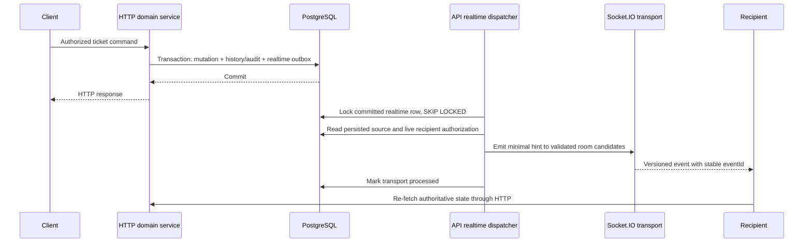

# Authenticated realtime delivery — Phases 5A and 5B

The API hosts an authenticated Socket.IO namespace at `/realtime`, on its existing HTTP port using the `/socket.io/` path and WebSocket transport only. Phase 5B adds outbox-backed ticket hints and live delivery of persisted notifications. PostgreSQL remains authoritative. No ticket mutations are accepted over Socket.IO, and Phase 5C now provides the [frontend client/shell](frontend-architecture.md); presence, typing, and incident features remain unimplemented.

## Authentication and organization selection

Clients connect using `auth: { token: accessToken }`. Query-string tokens, arbitrary rooms, and client-provided user/role claims are not accepted. The handshake allows exactly the token field. The shared `AccessTokenService` verifies HS256, issuer, audience, expiry, issuance field, UUID identities, and the live unrevoked/unexpired refresh-session row for an active user. HTTP and realtime use the same verifier. The raw handshake token is cleared; only a server-verified identity is retained. Access expiry disconnects the socket and releases local context/timers. Refresh through HTTP, reconnect with replacement credentials, and select an organization again.

`connection:ready` confirms authenticated transport, without automatically selecting any organization. `organization:join` accepts exactly `{ organizationId: UUID }`, rechecks session and current membership/role, and joins server-generated organization/member rooms. Unknown and inaccessible organizations have identical denial responses. Each socket selects one organization; separate sockets may select independently.

Switching first leaves previous rooms and clears context. Success emits `organization:left` followed by `organization:joined`; a failed switch leaves no active tenant. `organization:leave` is idempotent. Join/leave operations are bounded to one in flight per socket; competitors receive `BUSY`. Disconnect during lookup cannot restore context. A selection revision invalidates in-flight emissions when a switch occurs, while concurrent role revalidations can safely coexist. Cleanup performs no database presence writes.

Join acknowledgement success is `{ ok: true, organizationId, membershipId, role }`; failure is `{ ok: false, code, message }`. Leave returns `{ ok: true, organizationId }`, using null when no context was selected. Codes are `INVALID_REQUEST`, `UNAUTHENTICATED`, `ACCESS_DENIED`, `BUSY`, and `UNAVAILABLE`, with fixed sanitized messages. Clients should use acknowledgement timeouts. `error` is the reserved server error contract, currently used for access expiry.

```ts
// Future client protocol example; no frontend package is installed.
const socket = io('http://localhost:4000/realtime', {
  transports: ['websocket'],
  auth: { token: accessToken },
});
socket.on('connection:ready', () => {
  socket.emit('organization:join', { organizationId }, (result) => {
    // On success, fetch current HTTP state before applying subsequent hints.
  });
});
socket.on('ticket:status-changed', (hint) => {
  // Deduplicate hint.eventId and reconcile through HTTP.
});
```

## Transactional domain events

Domain services depend only on persistence helpers under `infrastructure/outbox`; they never call Socket.IO or import the gateway. Ticket creation, assignment/reassignment, lifecycle transitions (including cancellation), and comments write minimal realtime outbox snapshots in the same transaction as business state, histories, and audits. A stale `expectedVersion`, illegal command, audit failure, or outbox failure rolls back the transaction and produces no committed event. Initial assignment emits both assignment and status-change records because it also transitions to ASSIGNED; reassignment emits only assignment.

`createNotifications(tx, data)` creates notification rows and one `NOTIFICATION_CREATED` outbox row per persisted notification atomically. SLA breach processing uses this helper inside its existing idempotent breach transaction. Future application notification writers must use it; arbitrary external SQL inserts do not automatically create delivery rows. Mark-read updates an existing notification and emits no new notification.



## Outbox channels and dispatcher ownership

The existing `OutboxEvent` table now supports explicit delivery purposes. `SLA_EVENT_SCHEDULED` and `SLA_EVENT_COMPLETED` remain ID-only sources for the separate BullMQ worker. Ticket realtime rows have a tenant-scoped ticket reference and minimal immutable JSON snapshot. Notification realtime rows reference the persisted notification; the delivery mapper reads its intended public fields. One source row has one destination purpose and one processed state. SLA scheduling and realtime delivery never share a processed flag on the same row.

The SLA dispatcher explicitly claims only its two event types. The realtime dispatcher explicitly claims ticket/notification types and runs in the **API process owning Socket.IO**, not in the SLA worker. No Socket.IO calls occur in the SLA worker. Starting the API starts its modest outbox interval; no additional realtime process or container is required. `OUTBOX_POLL_INTERVAL_MS` is shared with existing outbox infrastructure, defaulting to 2000 milliseconds.

Each dispatcher claims at most 25 rows per tick using `FOR UPDATE SKIP LOCKED`, with a transaction per row. The row remains locked until transport acceptance and processed marking, preventing concurrent dispatchers from knowingly delivering the same pending row. Dispatch cycles do not overlap within a runtime. PostgreSQL transaction timeout for realtime delivery is 15 seconds; long/failed operations remain retryable. Recipient validation adds database work proportional to connected room candidates, so monitor delivery latency and pool pressure as connection counts grow. This is an initial single-instance engine, not a high-volume fan-out service.

The transport abstraction `RealtimeEmitter` receives its namespace through gateway initialization, without a static/global server. An unavailable transport or meaningful delivery/database failure preserves the source row with `REALTIME_DELIVERY_FAILED`, increments attempts, and exponentially backs off from one second to five minutes. Transient retries have no finite attempt ceiling. Unknown/malformed snapshot contracts are quarantined using `failedAt` and `INVALID_REALTIME_EVENT`; they remain unprocessed and retained for operator investigation. Logs include only event UUID, explicit type, destination category, and fixed error code. Payloads, credentials, raw errors, and database details are not logged.

To recover a quarantined row, investigate/fix its source contract, then deliberately clear `failedAt` and `lastError` and set `nextAttemptAt` to the current time for that specific row through controlled database administration. Do not mark it processed to hide a failure. There is no public recovery HTTP endpoint. Existing `worker:recover` commands remain SLA-only.

Successful transport handoff counts as processed even if there are no currently connected/authorized recipients. There is no client-receipt acknowledgement requirement or offline inbox replay over Socket.IO. Processed realtime rows older than seven days are deleted in batches of at most 1000 per tick. Pending failures and quarantined rows are preserved and require operational monitoring; outages can grow this retained backlog. SLA source retention/recovery semantics remain separate and unchanged.

Shutdown stops the interval, waits for in-flight dispatch, detaches the transport, then closes Socket.IO/Redis/Prisma through existing lifecycle hooks. Forced death can replay a delivery, as described below.

## Public contracts and serialization

Every domain hint contains `schemaVersion: 1`, stable `eventId` (the outbox UUID), `organizationId`, and `occurredAt` as an ISO 8601 UTC string. Ticket hints also contain `ticketId`, `ticketNumber`, and workflow `version`.

| Event                   | Additional fields                                                          | Current behavior                                              |
| ----------------------- | -------------------------------------------------------------------------- | ------------------------------------------------------------- |
| `ticket:created`        | `status`, `priority`                                                       | Ticket creation                                               |
| `ticket:updated`        | None beyond common ticket fields                                           | Reserved; no generic editable-field mutation currently exists |
| `ticket:assigned`       | `assignedMemberId`, `assignedTeamId`, `previousMemberId`, `previousTeamId` | Initial assignment/reassignment; nullable identifiers         |
| `ticket:status-changed` | `fromStatus`, `toStatus`, `actorMemberId`                                  | Successful lifecycle transitions                              |
| `ticket:comment-added`  | `commentId`, `visibility`, `authorMemberId`                                | PUBLIC and INTERNAL staff comments                            |
| `notification:new`      | `notificationId`, `type`, `title`, `message`, `createdAt`                  | Persisted notification creation; member-only                  |

Comments never include their bodies. Ticket subjects, descriptions, customer objects, histories, hashes, tokens, and unrestricted audit metadata are absent. Payloads use explicit whitelist mappers and enum/UUID/integer/date validation; unknown snapshot fields are rejected rather than serialized. Notifications intentionally include the same concise title/message intended for their recipient. No raw Prisma object, Decimal, BigInt, or Date object is emitted.

## Room targeting and live authorization

`org:<organizationUUID>` and `member:<membershipUUID>` are internal server-generated rooms, never client parameters. The emitter takes their current local socket IDs as **candidates**, then validates each recipient and emits individually. It never authorizes a bulk room emit using stale room membership.

Before each domain hint, `RealtimeRoomService.revalidate(socket)` checks live session, active user, current membership, and current role. Removed memberships lose tenant rooms/context; revoked/expired sessions and inactive users are disconnected on a relevant emission. Ticket candidates additionally pass the existing `accessibleTickets` policy against current persisted state: AGENTs see only their assigned tickets or current teams' tickets; other current staff roles retain existing HTTP visibility. Team removal and role changes therefore affect the next relevant emission without reconnecting. Previously assigned agents do not receive later hints for tickets they can no longer read.

Notifications target only the persisted recipient's member room, with live organization/membership/session checks. They are never broadcast to the whole organization or team. Current selection, membership ID, connected state, and selection revision are checked after asynchronous lookups so an organization switch cannot receive the old context's in-flight event.

Authorization is sampled immediately before emission; a concurrent membership change immediately after a database read can still race a send. There is no distributed atomic transaction spanning authorization and network receipt. Future stronger revocation guarantees would require explicit synchronization/invalidation. Idle sockets are not actively watched for database revocation, but are untrusted until revalidation and disconnect at access expiry; no future domain hint relies on the original cached role alone. Dependency failures fail closed, may clear local context, and require the client to reconnect/reselect and re-fetch.

## Duplication, ordering, and reconnects

A crash after emit but before PostgreSQL marking can replay the same outbox row. A failure partway through recipient delivery can also repeat hints to recipients already reached. Retries always retain the same `eventId`; clients must deduplicate by event ID. Successfully marked rows are not knowingly dispatched again. This is retry-capable, at-least-once-style transport handoff with possible duplicate hints, **not exactly-once delivery** and not guaranteed receipt by every client. Socket.IO's own transport can lose a message during disconnect.

No global or per-ticket commit ordering is promised across concurrent dispatchers or retries. A client seeing workflow version 9 followed by 8 must ignore stale state or re-fetch, never roll state backward. Assignment and status events may share one version. Comments do not increment the workflow version and may share it with earlier events: deduplicate by `eventId`/comment ID rather than dropping every equal-version event. An initial HTTP response and a hint can arrive in either order.

Reconnect always authenticates, explicitly joins, and re-fetches current HTTP state. No event offset, replay log, or missed-event stream is implemented. Persisted ticket state and recipient notification inbox are the recovery path. Realtime accelerates discovery of changes; it does not replace persistence.

## Configuration, scaling, and health

`FRONTEND_ORIGINS` is an exact comma-separated allowlist: locally `http://localhost:3000`; production requires explicit HTTPS origins. Wildcards, credentials, paths/trailing slashes, and browser `null` origin are rejected. The custom adapter uses `allowRequest` on WebSocket upgrades as well as CORS options. Native clients without an Origin header still require valid credentials. `configureRealtime(app)` must run before listening; default gateway upgrades fail closed if a custom bootstrap omits it. Packets above 8192 bytes disconnect; namespace connection timeout is ten seconds. Per-event/account rate limiting and connection caps remain deferred.

Deploy **one Socket.IO/API instance** for this phase. Local rooms and validated emissions are not distributed. Running competing API dispatchers on different instances would let one mark an event delivered only to its own clients; database claims alone do not solve fan-out. Horizontal scaling needs a future Redis adapter plus coordinated recipient authorization/invalidation and delivery ownership. The SLA Redis connection does not automatically provide Socket.IO fan-out. Connection-state recovery remains disabled.

Existing `/health` liveness and `/ready` PostgreSQL/Redis readiness are unchanged; neither promises client receipt, realtime backlog freshness, or multi-node fan-out. Gateway initialization and sanitized dispatch errors are logged. Monitor pending count/age, quarantine count, repeated attempts, and database/transport capacity.

## Migration and verification

Migration `20261025030000_realtime_delivery` extends outbox types, makes the SLA reference optional for other delivery purposes, adds ticket/notification tenant-safe references, JSON snapshot and quarantine fields, destination uniqueness/indexes, and a SQL delivery-shape check. It preserves existing SLA records and earlier migrations. Apply through the existing `prisma:migrate:deploy` command; no reset or seed is required.

Run `pnpm lint`, `pnpm typecheck`, `pnpm test`, and `pnpm build`. Export a dedicated migrated `TEST_DATABASE_URL` for real Socket.IO tests and `TEST_REDIS_URL` for the existing real BullMQ suite. Domain suites disable automatic polling and drive the actual dispatcher explicitly so multiple test applications cannot consume one another's sources unpredictably. Fixtures target only tracked rows/isolated queues. Real tests inspect received packets and actual server rooms, use protocol acknowledgements to check negative delivery without arbitrary sleeps, and cover retries, crash-window duplicates, rollback, recipient/tenant boundaries, role changes, revocation, quarantine, and reconnect recovery.

Built-process verification starts the API and separate SLA worker with disposable PostgreSQL and isolated Redis, connects two organization clients, checks creation/assignment/status/minimal comments, observes a real worker-produced SLA notification, and verifies membership removal after join.

Deferred work includes full frontend feature screens, presence/typing, incidents, customer portal, email/SMS, realtime mutations, Redis fan-out, replay/offset recovery, per-event abuse controls, and automated quarantine tooling.

See [Socket.IO delivery guarantees](https://socket.io/docs/v4/delivery-guarantees/) and [room semantics](https://socket.io/docs/v4/rooms/).
