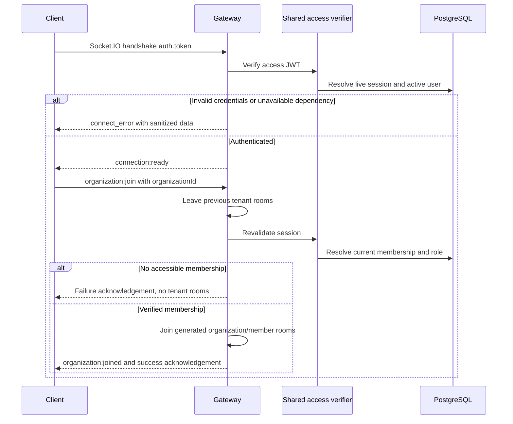

# Authenticated realtime transport — Phase 5A

The NestJS API hosts a Socket.IO namespace at `/realtime` on its existing HTTP port, using the `/socket.io/` transport path. Only WebSocket transport is enabled. The gateway authenticates connections and manages one explicitly selected organization context per socket. No ticket broadcasts, notification delivery, presence, frontend realtime client, incident behavior, or Redis adapter is implemented.

## Connection and authentication

A Socket.IO client supplies `auth: { token: accessToken }`. This is a Socket.IO connection, not a raw WebSocket JSON protocol. Query-string tokens and client-supplied user IDs, roles, room names, and tenant claims are not accepted as authentication. The handshake auth object allows exactly the `token` field; an Authorization-header fallback is intentionally not supported.

```ts
// Protocol example for a future client; no frontend dependency is added.
const socket = io('http://localhost:4000/realtime', {
  transports: ['websocket'],
  auth: { token: accessToken },
});
socket.on('connection:ready', ({ ok }) => {
  socket.emit('organization:join', { organizationId }, (result) => {
    // result is a verified context or a sanitized failure.
  });
});
```

`AccessTokenService` is shared by the HTTP bearer guard and realtime authentication. It verifies HS256, issuer `pulsedesk-api`, audience `pulsedesk-web`, expiry, issuance field, and UUID `sub`/`sid`, then resolves the live, unrevoked, unexpired refresh-session row belonging to an active user. JWT validity alone never grants connection or organization access. Missing, malformed, expired, revoked, mismatched, inactive, or deleted identities are rejected through Socket.IO `connect_error` with safe error data. Unexpected dependency errors use a generic unavailable result and fixed logs without tokens, request payloads, exception objects, or database details.

The socket retains only a server-verified identity `{ userId, sessionId, expiresAt }`; the raw handshake token is cleared after authentication. Access expiry disconnects the socket and clears its context. There is no in-place token refresh event: obtain replacement credentials through the existing HTTP refresh contract and reconnect. Refresh rotation immediately makes the old session fail the next live check. There is no push-based logout/membership revocation subscription in this phase; an idle connected socket can remain until access expiry, with no domain broadcasts being delivered.



## Organization selection and event contracts

Connections initially join only Socket.IO's private socket-ID room. They do not automatically select a tenant, even for users with one membership. `organization:join` requires exactly `{ organizationId: UUID }`, with no extra fields, arrays, null, or arbitrary room strings.

Each join rechecks the live session and queries the current membership/active user. The current database role is authoritative. Unknown and inaccessible organizations return the same `ACCESS_DENIED` response. The response intentionally includes no cross-tenant existence information.

| Event                 | Direction and payload                                                     |
| --------------------- | ------------------------------------------------------------------------- |
| `connection:ready`    | Server → client, `{ ok: true }`, authenticated transport only             |
| `organization:join`   | Client → server, `{ organizationId }`, with acknowledgement               |
| `organization:joined` | Server → client, same verified context as successful join acknowledgement |
| `organization:leave`  | Client → server, no payload, with acknowledgement                         |
| `organization:left`   | Server → client, `{ ok: true, organizationId: UUID \| null }`             |
| `error`               | Reserved server error contract, currently used on access expiry           |

Join success is `{ ok: true, organizationId, membershipId, role }`. Failure is `{ ok: false, code, message }`. Codes are `INVALID_REQUEST`, `UNAUTHENTICATED`, `ACCESS_DENIED`, `BUSY`, and `UNAVAILABLE`; messages are fixed and do not contain database errors or token internals. Leave success is `{ ok: true, organizationId }`, with null for an already unselected socket. Clients must use Socket.IO acknowledgement timeouts to handle disconnection or transport loss.

One socket has one active organization. Switching first clears the previous context and leaves its organization/member rooms, then validates the requested organization. A successful switch emits `organization:left` before `organization:joined`. A failed switch leaves the socket authenticated but without any tenant context or tenant rooms. Rejoining revalidates role/membership rather than trusting the cached role. Separate tabs/connections may independently select different organizations.

A per-socket in-flight flag permits one context operation at a time; concurrent joins/leaves return `BUSY` rather than building an unbounded promise queue. Disconnect during a membership lookup cannot restore context or room membership. Disconnect removes expiry timers and local identity/tenant state and relies on Socket.IO to remove adapter room memberships. It performs no database writes or persisted presence updates.

## Internal rooms and future authorization

`RealtimeRoomService` generates `org:<organizationUUID>` and `member:<membershipUUID>` internally. Membership UUIDs refer to organization membership, not global users. Room names are an internal implementation detail, never accepted as public join parameters. No generic join-room handler exists, and successful responses do not expose room names.

The verified local context is `{ userId, organizationId, membershipId, role }`. It is a snapshot, not permanent authorization. `RealtimeRoomService.revalidate(socket)` rechecks session, active user, current membership, and current role; invalid authorization clears tenant rooms/context. Future sensitive actions must call this helper before executing and apply their explicit role/domain permissions. HTTP `expectedVersion` and transactional domain authorization remain authoritative for future mutations.

Future sensitive emissions must also revalidate each intended recipient before delivery, or implement an equivalent tested invalidation mechanism. Direct `server.to(orgRoom).emit(...)` based only on historic room membership would permit stale recipients after logout, role changes, or membership removal and is not an authorized broadcast architecture. This phase deliberately exports the revalidation service without introducing a ticket/notification broadcast method. Room membership itself cannot make later operations immune to concurrent membership changes; sensitive transactional writes still need in-transaction authorization, and future delivery requires an explicit race policy.

## Origins, transport limits, and deployment

`FRONTEND_ORIGINS` is a comma-separated list of exact origins, for example `http://localhost:3000` locally or `https://desk.example.com` in production. Development/test defaults to localhost:3000. Production must configure an explicit nonempty HTTPS list. Wildcards, credentials, paths, trailing slashes, and the browser `null` origin are rejected. Startup validates the setting rather than silently permitting all origins.

`configureRealtime(app)` installs the custom Nest Socket.IO adapter before listening; custom application bootstraps and integration tests must call the same helper. The gateway defaults to denying upgrades if that adapter setup is omitted. The adapter enforces the origin allowlist through `allowRequest` on WebSocket upgrades as well as CORS configuration. CORS headers alone do not protect WebSocket connections. Native clients without an Origin header are permitted but must still provide valid credentials; an Origin header is not authentication and can be forged by non-browser clients.

The transport rejects packets above 8192 bytes and disconnects the connection; the namespace connection timeout is ten seconds. Request schemas reject unexpected fields. There is no complex per-event/IP/account limiter yet. Configure deployment connection limits, TLS, proxy upgrade support, and operational monitoring; keep API access-token responses out of logs. Per-event rate limits and connection/session caps remain future work.

The default in-memory adapter is **single-instance only**. Rooms, context, and expiry timers do not coordinate across replicas. Redis already used by the SLA worker does not automatically distribute Socket.IO events. Horizontal scaling needs a future Socket.IO Redis adapter and a reviewed strategy for cross-node authorization/invalidation and connection routing. Connection-state recovery is not enabled, so reconnects always authenticate and explicitly select a tenant again.

`/health` and `/ready` retain their current semantics. Gateway initialization logs startup; registration or adapter initialization failure propagates through API startup. There is no separate fabricated realtime health flag, and readiness does not claim distributed delivery or client connectivity.

## Verification and scope

Run the existing lint, typecheck, test, and build commands. Export a dedicated migrated `TEST_DATABASE_URL` for real Socket.IO/PostgreSQL integration tests; existing SLA tests additionally require `TEST_REDIS_URL`. Fixtures use randomized users/organizations/sessions and remove only tracked rows. No production data, reset, debug HTTP endpoints, or frontend socket package is used. Tests inspect the gateway's actual namespace rooms and socket data through Nest test instrumentation, exercise real WebSocket clients, and verify sanitized acknowledgements and cleanup.

Built-process smoke verification logs in over HTTP, connects with the returned access token, joins an organization, receives `organization:joined`, disconnects, revokes the session through logout, and verifies reconnection rejection. Existing health/readiness and SLA worker checks remain included.

Deferred features are ticket broadcasts, live notification delivery, presence, frontend realtime UI/client, incidents, Redis fan-out, automatic revocation push, in-place token replacement, per-event abuse controls, and domain event delivery/replay guarantees.

The implementation follows the [Nest gateway lifecycle](https://docs.nestjs.com/websockets/gateways) and [Socket.IO server configuration](https://socket.io/docs/v4/server-options/).
