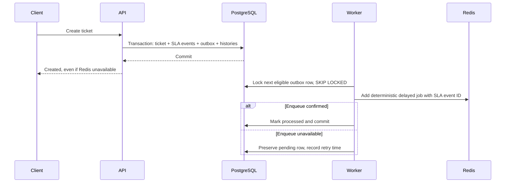

# SLA engine — Phase 4

The API records SLA state in PostgreSQL. A separately started BullMQ worker dispatches the transactional outbox and executes Redis-backed delayed jobs. HTTP requests never perform deadline processing. There are no ticket scans or in-process deadline timers; the only polling interval dispatches bounded outbox batches.

## Startup and configuration

Use the existing PostgreSQL and Redis Compose services. Configure the ignored root `.env` with `DATABASE_URL`, `REDIS_URL`, and the API's existing strong `JWT_ACCESS_SECRET`. No real environment file or secret is committed. The following is production-style local startup; daily development uses the single `pnpm dev` command described below.

```sh
docker compose up -d --wait
pnpm --filter @pulsedesk/api prisma:migrate:deploy
pnpm build
# Separate terminals:
pnpm --filter @pulsedesk/api start
pnpm worker
# Optional web process:
pnpm --filter @pulsedesk/web start
```

For development, root `pnpm dev` starts web, API and the TypeScript worker together through Turborepo. It generates Prisma Client once and prepares shared packages; no application build is required. `pnpm worker:dev` runs only the watched worker with the same preparation. The API process itself never starts a worker. `pnpm worker` remains the compiled production-style command shown above. The worker uses the same local/root environment-file precedence as the API, but does not require the API signing secret.

| Setting                   | Meaning                                                                                                     |
| ------------------------- | ----------------------------------------------------------------------------------------------------------- |
| `REDIS_URL`               | Required `redis://` or `rediss://` connection URL, database 0–15; local example `redis://localhost:6379`    |
| `SLA_QUEUE_PREFIX`        | Shared API/worker deployment namespace, default `pulsedesk`; 1–80 letters, numbers, hyphens, or underscores |
| `OUTBOX_POLL_INTERVAL_MS` | Worker dispatch interval, default 2000; range 100–60000                                                     |
| `TEST_DATABASE_URL`       | Explicitly exported, dedicated migrated PostgreSQL test database                                            |
| `TEST_REDIS_URL`          | Explicitly exported test Redis URL; SLA integration tests require both test URLs                            |

Use the same queue prefix for all replicas serving one deployment and distinct prefixes for other deployments. Redis should use persistence, backups, and `noeviction`; the existing local service uses AOF. Configure TLS, credentials, access restrictions, monitoring, and backup recovery for production. Test suites generate independent random prefixes and remove only their own queues, never flush Redis.

`GET /health` remains application liveness: `{ "status": "ok", "service": "pulsedesk-api" }`. `GET /ready` performs a lightweight PostgreSQL query and Redis ping, returning `{ "status": "ok", "service": "pulsedesk-api" }` or a sanitized `503`. Readiness does not establish that a separate worker is running. Monitor worker startup/dependency/terminal-failure logs and queue/outbox lag operationally. Redis failure allows API startup in degraded mode; PostgreSQL connection failure still prevents startup.

## Policy and time semantics

Ticket creation selects the active policy matching the current organization and ticket priority. The existing PostgreSQL partial unique index permits at most one active policy for each organization/priority. No match means a successful ticket with no SLA events or synthetic defaults.

A match creates exactly one `FIRST_RESPONSE` and one `RESOLUTION` event with policy ID, ticket ID, and deadlines. Both start at the ticket creation timestamp; `dueAt = createdAt + configuredMinutes * 60000`. All arithmetic uses UTC instants and continuous elapsed minutes. Every application PostgreSQL connection explicitly sets its session timezone to UTC because the Prisma PostgreSQL adapter normalizes timestamptz text assuming UTC, independently of the database server's default timezone. Daylight-saving changes have no effect. Business hours, holidays, regional calendars, pauses, and reopening are deferred. Keep server clocks synchronized; BullMQ uses wall-clock time, and the processor independently verifies the persisted deadline against an injected clock before writing.

Policy edits/deactivation affect new tickets only. Existing event deadlines retain their original instants; policy rows are referenced rather than copied/versioned. There is no policy hard-delete endpoint. Cancellation makes outstanding jobs no-op and produces a derived `CANCELLED` status without pretending that a response or resolution occurred. Waiting for the customer does not pause an SLA.

The first successfully committed **PUBLIC staff comment** completes first response. INTERNAL comments do not. Row locking and a conditional update retain the first completion timestamp, including concurrent comments. The comment, completion, and completion audit commit together. Transitioning to **RESOLVED** completes resolution in the same workflow transaction; CLOSED is not a second completion trigger. Existing breach timestamps are never erased by completion.

A response/resolution committed after its deadline also creates an ID-only `SLA_EVENT_COMPLETED` outbox record. This handles a worker outage spanning both the deadline and a late response: a normal deadline job must no-op on completed events, so a separate asynchronous reconciliation job records the missed breach when `completedAt > dueAt`. An on-time completion never becomes a breach merely because its job runs late. `breachedAt` records processing time, while `dueAt` records the violated deadline.

## Transactional outbox and delayed jobs

Ticket creation commits the ticket, history/audit, SLA events, and `SLA_EVENT_SCHEDULED` outbox rows in one PostgreSQL transaction. Any failure rolls the entire mutation back, including the ticket-number allocation. The minimal outbox stores typed `organizationId`, `slaEventId`, and event-type columns rather than arbitrary JSON. Its composite foreign key proves that the referenced SLA event belongs to the same tenant. `(slaEventId, type)` is unique.



The worker dispatches at most 25 messages per interval, locking one pending row per transaction using `FOR UPDATE SKIP LOCKED`. Other dispatchers skip locked rows. PostgreSQL row locks cover enqueue confirmation; Redis commands have finite producer timeouts, and dispatcher transactions have bounded timeouts. Only confirmed enqueue marks a row processed. Failed deliveries retain a sanitized error code and exponentially back off from one second to five minutes, without a finite retry limit.

PostgreSQL and Redis do not share a transaction. A crash after enqueue but before database commit can replay an enqueue. Deterministic BullMQ job IDs suppress duplicates while retained; database-side processing remains idempotent even after Redis history expires. This is recoverable at-least-once delivery, not a cross-system exactly-once guarantee.

Queue name is `sla`. Typed payloads contain exactly `{ slaEventId: string }`; ticket/customer/member objects and secrets never enter job data. Names are `sla:first-response:deadline`, `sla:resolution:deadline`, and `sla:completion:reconcile`. Deadline IDs are `sla-event-<UUID>`; reconciliation IDs are `sla-completion-<UUID>`. Hyphens avoid BullMQ's reserved colon in custom IDs. Delays are `max(0, dueAt - now)`; late dispatch runs immediately.

## Breaches, recipients, and idempotency

The processor validates the job name and UUID payload, then re-reads authoritative PostgreSQL state. It locks the SLA event and checks tenant-matching ticket state. Missing events, canceled tickets, completed deadline events, and already breached events safely no-op. An unexpectedly early job moves back to its persisted due time rather than completing and losing the deadline. Reconciliation accepts only completed events whose completion was late.

```mermaid
sequenceDiagram
    participant Redis
    participant Worker
    participant PG as PostgreSQL
    Redis->>Worker: Delayed SLA event ID
    Worker->>PG: Begin; lock SLA row; read event and tenant ticket
    alt Missing, canceled, completed, or already breached
        Worker->>PG: No-op and commit
    else Deadline still in future
        Worker->>Redis: Move job back to dueAt
    else Eligible breach
        Worker->>PG: Conditional breach update
        Worker->>PG: Active recipient notifications + system audit
        PG-->>Worker: Atomic commit
    end
```

Breach timestamp, notifications, and system audit share one transaction. A notification/audit failure rolls back the breach so the job can retry. Duplicate/concurrent jobs serialize on the event row and create one set of side effects. There is no claim that Redis itself atomically commits PostgreSQL effects.

Recipients are current active users' memberships with OWNER, ADMIN, or MANAGER roles, plus the ticket's assigned member if active. Memberships are selected in the event's organization and deduplicated. A team assignment does not broadcast to every team member. Notification types distinguish `SLA_FIRST_RESPONSE_BREACHED` and `SLA_RESOLUTION_BREACHED`. Content includes the ticket reference and deadline kind, with `entityType: "Ticket"` and the ticket UUID; it omits descriptions, internal comments, and customer details.

## HTTP contracts

All endpoints require a live bearer session and `X-Organization-Id`. Existing validation, sanitized errors, and tenant authorization apply.

| Endpoint                        | Access and behavior                                                                                                              |
| ------------------------------- | -------------------------------------------------------------------------------------------------------------------------------- |
| `GET /sla/policies`             | All current member roles, including AGENT; bounded `page`/`limit`, creation descending with ID tie-breaker                       |
| `POST /sla/policies`            | OWNER or ADMIN; `name`, `priority`, `firstResponseMinutes`, `resolutionMinutes`, optional `isActive` (default true); returns 201 |
| `PATCH /sla/policies/:id`       | OWNER or ADMIN; nonempty subset of those fields; returns 200; foreign/missing ID 404                                             |
| `GET /tickets/:id`              | Existing ticket visibility rules; adds `sla` safe event array                                                                    |
| `GET /notifications`            | Current organization membership's notifications only; `page`, `limit`, optional `unread=true                                     | false`; creation descending, ID descending |
| `PATCH /notifications/:id/read` | Recipient only; sets first `readAt`, repeated calls preserve it; foreign/other-recipient ID 404                                  |

Policy names are trimmed, 1–100 characters; durations are integers from 1 to 525600 minutes. Priorities are LOW, MEDIUM, HIGH, URGENT. Nulls, unexpected body fields, and invalid values return 400; an active-policy conflict returns 409. Policy updates write an audit and revalidate actor membership/role in the transaction.

Pages default to 1 and size 20, with maximum page 10000 and size 100. List responses use the existing `{ data, pagination: { page, limit, total, totalPages } }` envelope. `unread=true` selects unread; `false` selects read; absent selects both. Notification mutation rechecks current tenant membership transactionally.

Ticket `sla` exposes only `id`, `type`, `dueAt`, `completedAt`, `breachedAt`, and derived `status`. BREACHED takes precedence over COMPLETED, then CANCELLED, then PENDING; a late completed event can remain visibly BREACHED. Pending events can briefly remain PENDING after due time while queued processing catches up.

## Outages, retention, and recovery

API mutations depend on PostgreSQL and the outbox, never successful Redis delivery. Producer connections fail within bounded time; worker connections use BullMQ-compatible unlimited request retry and reconnect. When Redis recovers, the dispatcher resumes pending outbox delivery. Worker jobs have seven attempts with exponential backoff beginning at one second. Permanent payload/type errors use `UnrecoverableError`; terminal failures emit sanitized logs and remain available for diagnosis.

Completed jobs retain up to 1000 records for one day; failed jobs up to 1000 for seven days. BullMQ applies age/count cleanup as jobs finish, so an idle queue can retain older records until subsequent activity. The event stream is approximately capped at 5000 entries. Pending/delayed work must remain until executed; capacity planning and queue-age alerts are required.

Processed outbox cleanup is bounded to 1000 terminal rows per dispatch interval after seven days. Terminal means breached, completed on time, or canceled. Unprocessed failures and processed unfinished/late-unreconciled source records are retained for recovery; these can grow during a prolonged outage or abandoned work and require operational monitoring. No destructive cleanup of recoverable work runs automatically.

After investigating and fixing a terminal job failure, an explicit bounded operator command retries up to 100 valid failed jobs:

```sh
pnpm --filter @pulsedesk/api worker:recover retry-failed
```

After Redis data loss, replay retained source outbox records from PostgreSQL. This resets only still-required source rows and republishes them with the same deterministic IDs, removing a corresponding failed job only as part of this explicit recovery:

```sh
pnpm --filter @pulsedesk/api worker:recover replay
# If output includes nextCursor, continue with that UUID:
pnpm --filter @pulsedesk/api worker:recover replay <nextCursor>
```

Replay processes at most 100 source rows per invocation. Existing delayed/active jobs remain protected by deterministic IDs; completed database events remain protected by transactional idempotency. These commands use the selected deployment's database, Redis URL, and prefix: choose those deliberately. They do not scan every ticket, reset a database, or flush Redis. Failed jobs whose source remains unfinished are recoverable through replay even after Redis's failed-job retention expires. Redis durability and backups still matter; source retention and explicit replay are the recovery path, not automatic detection of Redis data loss.

SIGTERM/SIGINT stops the dispatcher interval, waits for its in-flight batch, then gracefully closes the worker while active jobs finish. Queue producers, Redis connections, and Prisma close during application shutdown after worker draining. Give deployments sufficient termination grace; forced process death relies on BullMQ stalled-job recovery and database transactions. No worker HTTP port is opened.

## Migration and verification

`20261025020000_sla_engine` adds the two notification enum variants, optional entity references, tenant-scoped SLA identity, and the outbox model/indexes/foreign keys/nonnegative-attempt constraint. Existing migrations, ticket history, and auth/session schema are unchanged. It is additive and needs no reset or seed.

```sh
pnpm --filter @pulsedesk/api prisma:validate
pnpm --filter @pulsedesk/api prisma:generate
pnpm lint
pnpm typecheck
# Export TEST_DATABASE_URL and TEST_REDIS_URL for full integration coverage:
pnpm test
pnpm build
```

Tests inject a fixed UTC clock for deadlines, completion, outbox retry, concurrency, and rollback checks. Dedicated PostgreSQL fixtures and random Redis prefixes cover policies, tenant/recipient boundaries, completion/breach races, queue outages, outbox replay/claims, failure rollback, cleanup, and operator recovery. A real BullMQ worker executes a short isolated deadline and an injected transient retry using job events, not an arbitrary sleep assertion. Without both explicit test URLs the SLA integration suite is skipped; the other PostgreSQL suites require `TEST_DATABASE_URL`. CI supplies isolated PostgreSQL and Redis services. Fixture cleanup targets only tracked rows and queues.

Separate built-process smoke verification exercises API registration, policy/ticket creation, delayed jobs, PUBLIC completion, RESOLVED completion, a test-only accelerated persisted deadline, notification delivery, readiness, and graceful worker SIGTERM. The public policy API intentionally does not accept fractional minutes just to shorten tests.

Deferred work includes distributed rate limiting, queue dashboards/metrics/alerts, automated disaster-recovery orchestration, business calendars, SLA pause/resume, priority edits/reopening semantics, email/SMS delivery, incident workflows, and frontend notification screens.

BullMQ configuration follows its [connection guidance](https://docs.bullmq.io/guide/connections), [custom job-ID constraints](https://docs.bullmq.io/guide/jobs/job-ids), and [graceful worker shutdown](https://docs.bullmq.io/guide/workers/graceful-shutdown).

## Phase 5B persisted live notifications

Breach processing now uses `createNotifications(tx, data)` to insert each notification and its own `NOTIFICATION_CREATED` outbox row in the same breach transaction. A failure rolls back notifications, delivery records, breach timestamp, and audit together. The SLA worker never calls Socket.IO. Its dispatcher claims only SLA scheduling/completion types; the API-owned realtime dispatcher separately claims notification/ticket types, so their processed states cannot compete. Notification delivery validates the current session/member and targets only the persisted recipient's member room. An offline recipient recovers from the existing notification HTTP inbox; no socket replay is promised. See [realtime delivery](realtime.md) for retry/duplication semantics, scaling, and revocation behavior.
