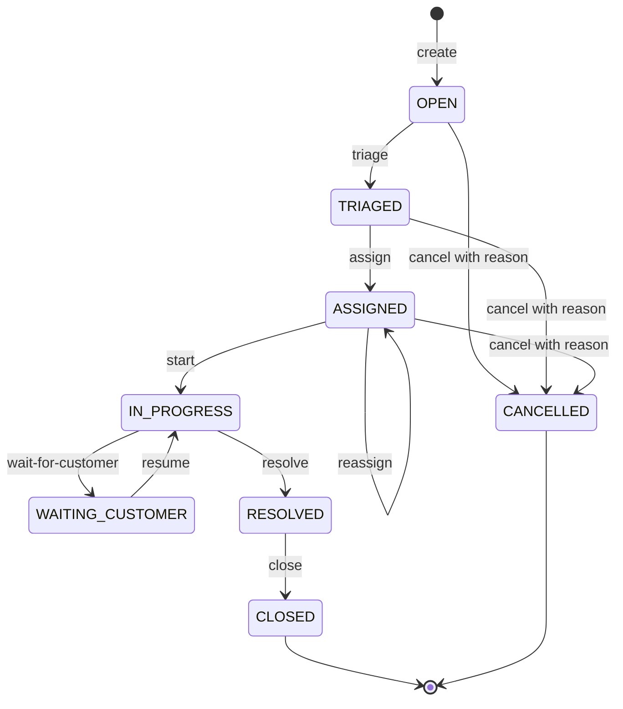

# Support operations and ticket lifecycle — Phase 3

This phase implements backend teams, customer records, and a tenant-scoped ticket workflow. Controllers validate input and pass the verified Phase 2 `TenantContext` to services. Services own authorization-sensitive queries, transactions, mapping, history, and auditing. There are no product frontend screens, incidents, realtime delivery, SLA execution, jobs, attachments, email ingestion, or AI features.

## Endpoints

Every route requires a live bearer access session and a verified `X-Organization-Id` header. Foreign resource IDs and inaccessible tickets return `404`; invalid input returns `400`, unauthenticated requests `401`, forbidden roles `403`, and uniqueness, stale-version, or lifecycle conflicts `409`.

| Resource          | Endpoints                                                                                                         |
| ----------------- | ----------------------------------------------------------------------------------------------------------------- |
| Teams             | `POST /teams`, `GET /teams`, `GET /teams/:id`, `PATCH /teams/:id`                                                 |
| Team membership   | `POST /teams/:id/members` with `{ membershipId }`; `DELETE /teams/:id/members/:membershipId`                      |
| Customers         | `POST /customers`, `GET /customers`, `GET /customers/:id`, `PATCH /customers/:id`                                 |
| Tickets           | `POST /tickets`, `GET /tickets`, `GET /tickets/:id`                                                               |
| Workflow commands | `POST /tickets/:id/triage`, `/assign`, `/start`, `/wait-for-customer`, `/resume`, `/resolve`, `/close`, `/cancel` |
| Comments          | `POST /tickets/:id/comments`                                                                                      |

Creation returns `201`; updates and workflow commands return `200`; team-membership removal returns `204`. No team/customer/ticket deletion endpoint is provided. No generic ticket PATCH or arbitrary status setter exists. Team/customer PATCH requests must contain at least one recognized field; their ordinary profile edits use last-write-wins semantics, while ticket workflow changes use version preconditions.

## Explicit permission matrix

There is no numeric role hierarchy. Each mutation declares an explicit role allowlist in the controller and checks current membership again in the transaction.

| Operation                                              | OWNER / ADMIN / MANAGER                       | AGENT                                   | VIEWER                   |
| ------------------------------------------------------ | --------------------------------------------- | --------------------------------------- | ------------------------ |
| Read teams/customers                                   | Yes                                           | Yes                                     | Yes                      |
| Create/update teams/customers; add/remove team members | Yes                                           | No                                      | No                       |
| Create ticket                                          | Yes                                           | Yes                                     | No                       |
| Read tickets and staff timelines                       | All organization tickets                      | Direct or current-team assignments only | All organization tickets |
| Triage / assign / reassign                             | Yes                                           | No                                      | No                       |
| Start / wait / resume / resolve                        | Any organization ticket in the required state | Accessible assigned tickets only        | No                       |
| Close / cancel                                         | Yes                                           | No                                      | No                       |
| INTERNAL or PUBLIC comment                             | Yes                                           | Accessible assigned tickets only        | No                       |

ADMIN has full operational access here; ownership-level organization operations are outside this phase. Organization membership management itself remains outside these APIs: team membership refers to an existing organization membership.

## States and commands

| Command                    | Required state             | Result                                                        |
| -------------------------- | -------------------------- | ------------------------------------------------------------- |
| `triage`                   | OPEN                       | TRIAGED                                                       |
| `assign`                   | TRIAGED                    | ASSIGNED                                                      |
| `assign` (changed targets) | ASSIGNED                   | ASSIGNED with new assignment history                          |
| `start`                    | ASSIGNED                   | IN_PROGRESS                                                   |
| `wait-for-customer`        | IN_PROGRESS                | WAITING_CUSTOMER                                              |
| `resume`                   | WAITING_CUSTOMER           | IN_PROGRESS                                                   |
| `resolve`                  | IN_PROGRESS                | RESOLVED and server-generated `resolvedAt`                    |
| `close`                    | RESOLVED                   | CLOSED and server-generated `closedAt`; preserve `resolvedAt` |
| `cancel`                   | OPEN, TRIAGED, or ASSIGNED | CANCELLED with a required history reason                      |

Every workflow command, including assignment, requires `{ "expectedVersion": <ticket.version> }`. Assignment also requires at least one target. Cancellation requires a trimmed, nonempty `reason` of at most 1,000 characters. Other transition commands may carry a reason with the same bounds. Missing or invalid version values return `400`; a stale version or incompatible state returns `409`. After a conflict, fetch the ticket and deliberately decide whether to issue a new command; do not blindly retry stale user intent.

No reopening, unassignment command, assignment during work, direct OPEN-to-resolved/closed shortcuts, or transitions out of CLOSED/CANCELLED are implemented. Assignment is prohibited in IN_PROGRESS, WAITING_CUSTOMER, RESOLVED, CLOSED, and CANCELLED even for management roles. AGENT may resolve an accessible ticket, but may never close or cancel it.

Creation accepts only `customerId`, `subject`, `description`, optional `priority` (default MEDIUM), and optional `source` (default WEB). The customer must belong to the verified organization. The server sets OPEN status, number, assignment, version, and lifecycle timestamps. Subject length is 1–200 and description 1–10,000 after trimming. Client-provided organization, status, number, assignment, version, resolved/closed timestamps, and unknown fields are rejected.

## Assignment and agent visibility

Assignment accepts a member only, team only, or both. All targets must belong to the current organization, and a member must have an active user. When both targets are supplied, the member must currently belong to the selected team; a same-organization mismatch returns `409`. A foreign or missing target returns `404`. Omitted targets are cleared: assigning only a new member replaces the previous team/member pair with that member and a null team. Null values and empty target sets are rejected. Repeating the same existing assignment returns `409` rather than manufacturing a new history entry.

Team-only assignment is enough for agents who are current members of that team to read, comment, and execute permitted working-state commands. Direct assignment independently grants access even if the agent does not belong to a selected team anymore. Team membership is checked at assignment time and in current visibility queries; removing a member does not rewrite current ticket assignments or historical records. After removal, a team-only ticket disappears for that agent on their next request, while direct assignment continues to grant access. This is an intentional OR rule.

Unassigned OPEN/TRIAGED tickets are not globally visible to AGENT. An AGENT may create a ticket and receive its creation summary, but cannot subsequently retrieve it until it is assigned directly or to one of their teams. A privileged routing role handles that queue. VIEWER can read organization tickets, including both comment visibilities, but cannot mutate them.

Authorization is part of SQL/Prisma filters, never post-filtering of already paginated results. User-supplied filters are ANDed with organization and agent visibility predicates. Foreign customer/member/team filters return an empty page rather than revealing whether those IDs exist elsewhere.

## Numbering, versioning, and concurrency

`OrganizationTicketCounter` contains one row keyed by the existing organization UUID, with `lastNumber`. This is an infrastructure counter, not a second domain identity. The new additive migration initializes counters from the maximum existing ticket number in every organization. New organizations lazily get a counter through an atomic PostgreSQL `INSERT ... ON CONFLICT DO UPDATE ... RETURNING` when their first ticket is created. No unprotected count/MAX calculation occurs at request time.

Allocation, ticket creation, initial OPEN history, and audit run in one transaction. Concurrent creates in one organization serialize on that counter row and receive distinct numbers. Different organizations have independent counters; both may have ticket 1. Failed transactions roll the allocation back. Responses expose the integer `ticketNumber` and formatted `reference`, such as `PD-000001`, separately from UUID `id`. References expand naturally beyond six digits. The existing organization/number unique constraint remains the final boundary. Exhausting the integer range returns `409` rather than wrapping. Direct SQL/import writers must maintain the counter; never manually lower it or allocate independent numbers.

`Ticket.version` starts at zero. Each successful assignment or status command conditionally updates `(organizationId, id, version, current status)` and increments the version. Comments do not alter workflow version. Two assignments with the same expected version cannot overwrite one another; start-versus-cancel and duplicate-close races have one winner and a `409` loser. There is no transparent retry that could reinterpret an outdated command as a newer reassignment.

The mutation transaction revalidates and holds shared locks on the actor membership and active user. A role change between the guard and that lock fails closed; the next request can resolve the new role. The locks prevent subsequent role/removal/deactivation changes from racing a committed mutation. Team-based agent commands and member/team assignments also lock the relevant team membership; removal takes an exclusive lock. Comment insertion holds a shared ticket lock while checking access, so assignment cannot change halfway through an authorized comment transaction. Composite foreign keys continue to enforce tenant consistency on writes. Constraint/serialization conflicts become `409`; lock/transaction resource failures fail without committing partial state.

List queries use repeatable-read snapshots for page rows and their total. Ordering is deterministic inside a request, but offset pages fetched at different times are not a frozen snapshot; cursor pagination is future work.

## History, comments, and audits

Ticket creation always inserts an initial status entry with `fromStatus = null`, `toStatus = OPEN`, and the acting membership. Each successful transition adds exactly one status entry with its previous/next status and optional reason. Cancellation reasons live in history, not in a new ticket column. Assignment adds an immutable-by-API assignment record and adds status history only when TRIAGED becomes ASSIGNED. Reassignment preserves earlier assignments and does not add a fictitious ASSIGNED-to-ASSIGNED status change. No history editing/deleting routes exist.

Comments accept a trimmed body of 1–10,000 characters and visibility INTERNAL (default) or PUBLIC. Authorized staff can read both in this phase, including on terminal tickets. PUBLIC denotes future customer-visible communication; a future customer portal must explicitly exclude INTERNAL comments and implement its own authorization. No customer-facing comment API or attachment support exists.

All listed mutations append `AuditLog` inside their business transaction: TEAM_CREATED, TEAM_UPDATED, TEAM_MEMBER_ADDED, TEAM_MEMBER_REMOVED, CUSTOMER_CREATED, CUSTOMER_UPDATED, TICKET_CREATED, TICKET_TRIAGED, TICKET_ASSIGNED, TICKET_REASSIGNED, TICKET_STARTED, TICKET_WAITING_CUSTOMER, TICKET_RESUMED, TICKET_RESOLVED, TICKET_CLOSED, TICKET_CANCELLED, and TICKET_COMMENT_ADDED. Logs carry organization, actor membership, entity type/ID, and only minimal identifiers/status context. They do not copy comment text, descriptions, customer notes/contact data, cancellation reasons, passwords, tokens, or hashes into metadata.

Ticket/counter/history/audit changes are atomic. The integration suite deliberately makes audit inserts fail and verifies rollback of creation/counter allocation, transitions, assignments, and comments. Database foreign keys preserve history references; append-only database privileges and retention policies remain future work.

## Queries and mapped responses

Teams and customers support `page`, `limit`, and optional `search`. Ticket lists additionally support `status`, `priority`, `customerId`, `assignedTeamId`, `assignedMemberId`, and `sort`. Unknown query keys, arrays, invalid UUIDs/enums, fractional/zero/negative/oversized page values, and arbitrary sort structures return `400`.

Pages default to 1 and size 20. Maximum page is 10,000 and maximum size 100. Results contain `{ data, pagination: { page, limit, total, totalPages } }`. Allowed ticket sorts are `createdAt:asc|desc`, `updatedAt:asc|desc`, `ticketNumber:asc|desc`, and `priority:asc|desc`, with an ID tie-breaker. Default is creation descending; priority ordering follows LOW, MEDIUM, HIGH, URGENT. Team/customer lists use creation descending and ID descending.

Customer search covers name, email, phone, and company; team search covers name. Ticket search covers case-insensitive subject substrings and exact integer/reference numbers (`1` or `PD-000001`). Searches escape LIKE wildcards and never accept arbitrary database fields. Substring searches and offset pagination may need PostgreSQL trigram/full-text indexing and cursor pagination as volume grows; this phase adds neither full-text search nor customer-name ticket joins.

Explicit mappers return only intended API fields. Ticket summaries contain ID, local number/reference, version, subject, status/priority/source, safe customer/assignment summaries, and timestamps. Detail adds description, comments, status history, and assignment history with limited member projections (membership/user IDs, name, avatar). No password/token hashes or raw Prisma model object is serialized.

Each ticket detail returns at most the latest 100 entries for each timeline, ordered chronologically by timestamp and ID, with `historyHasMore` flags for comments/status/assignments. Team detail returns its first 100 members in timestamp/ID order with `membersHasMore`. Dedicated cursor-based timeline/member endpoints are deferred; callers must not treat truncated detail as a complete archive.

## Migration, tests, and limitations

`20261025010000_ticket_operations` adds only the counter table and ticket version column, their nonnegative checks, and counter backfill. It does not edit the initial migration, remove history, change auth/session tables, or reset a database. Apply with the existing `prisma:migrate:deploy` command and verify `prisma:migrate:status`. Migrations remain authoritative for SQL-only checks and the Phase 1 active-policy partial index.

The HTTP integration suite uses randomized, isolated fixtures in an explicitly selected migrated `TEST_DATABASE_URL`. It covers CRUD permissions, same/foreign organization IDs, agent access and live team removal, search/filters/pagination, mass assignment, complete/invalid lifecycle paths, timestamps, assignment combinations/reassignment, comments, histories/audits, concurrent numbering, competing assignments, start/cancel races, duplicate close, and late audit failure rollback. Cleanup targets only tracked fixture organizations/users; it does not reset the database. Existing auth and database constraint tests remain part of CI.

Deferred functionality includes ticket field editing, unassignment, in-work transfer, reopening, team/customer archive/delete, member management/invitations, capability permissions, public customer portals, historical member-name snapshots, paginated full timelines, realtime events, incident management, frontend dashboards, attachments, email ingestion, and AI. Names in historical actor projections reflect current profile names; IDs and event timestamps remain stable.

## Phase 4 SLA integration

Ticket detail adds safe `sla` event projections. Creation writes policy-derived events and outbox rows atomically; no policy means no SLA. The first PUBLIC staff comment completes first response, and RESOLVED completes resolution, with transactional audits and retained breach timestamps. INTERNAL comments and CLOSED do not trigger completion. Cancellation prevents future breach processing. See [the SLA engine](sla-engine.md) for derived statuses, background execution, outage recovery, and non-retroactive policy changes.
